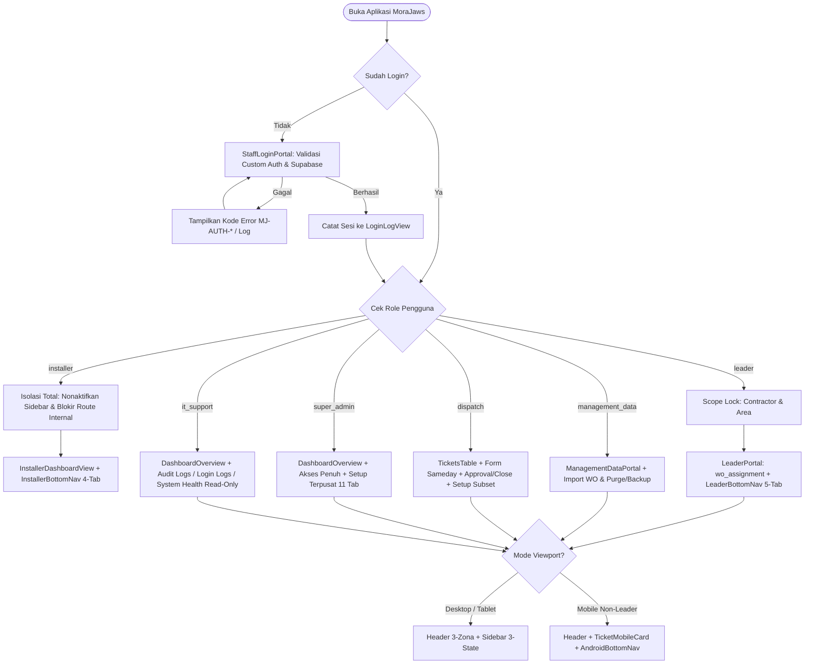
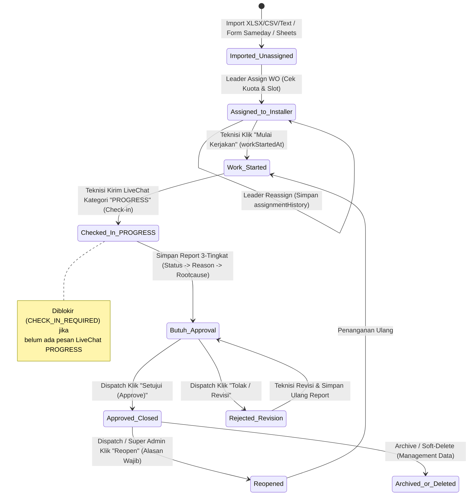
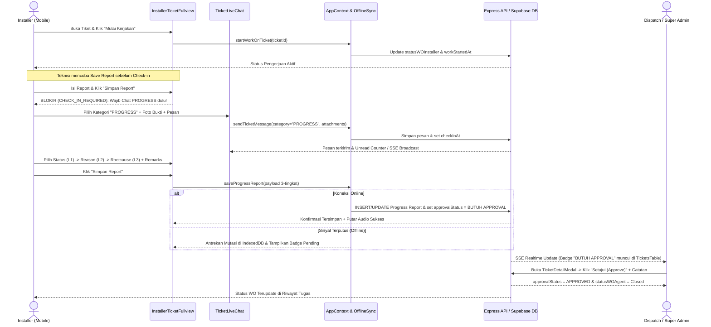
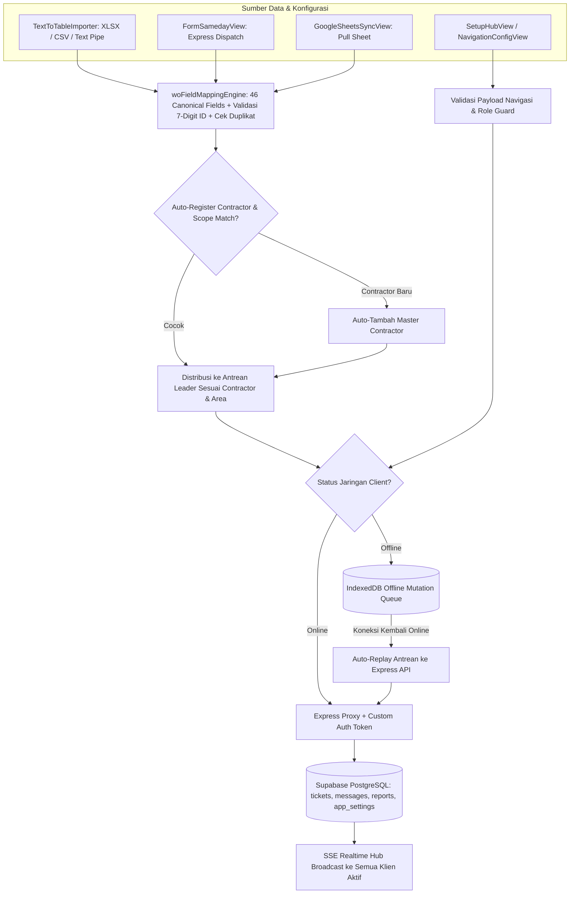

# Presentasi UI/UX, Fitur Aktual, AppFlow, Mermaid Flowchart & Wireframe — MoraJaws

> **Cakupan Dokumen**: Dokumentasi menyeluruh mengenai desain UI/UX, inventori fitur aktual, alur operasional (**AppFlow**), diagram **Mermaid**, dan **Wireframe Desktop & Mobile** untuk seluruh **6 role** pada aplikasi **MoraJaws (Dispatch & Work Order Management System)** berdasarkan implementasi codebase saat ini.

---

## Daftar Isi

1. [Ringkasan Eksekutif & Identitas Produk](#1-ringkasan-eksekutif--identitas-produk)
2. [Sistem Desain, Tema Visual & Ergonomi UI/UX](#2-sistem-desain-tema-visual--ergonomi-uiux)
3. [Arsitektur Role, Isolasi Keamanan & Shell Navigasi](#3-arsitektur-role-isolasi-keamanan--shell-navigasi)
4. [Inventori Fitur & Modul Aktual](#4-inventori-fitur--modul-aktual)
5. [Penjelasan End-to-End AppFlow & Diagram Mermaid](#5-penjelasan-end-to-end-appflow--diagram-mermaid)
6. [Koleksi Wireframe Desktop & Mobile (Seluruh Role & Layar Inti)](#6-koleksi-wireframe-desktop--mobile-seluruh-role--layar-inti)

---

## 1. Ringkasan Eksekutif & Identitas Produk

**MoraJaws** adalah sistem manajemen *Work Order* (WO) dan *Field Dispatch* operasional untuk layanan FTTH (*Fiber To The Home*) yang menghubungkan tim pusat (**Super Admin**, **Dispatch**, **Management Data**, **IT Support**) dengan mitra pelaksana di lapangan (**Leader / Korlap** dan **Installer / Teknisi**) secara *real-time* maupun *offline-capable*.

### Karakteristik Utama Arsitektur Aktual
- **6 Peran Staf Terisolasi**: `super_admin`, `dispatch`, `leader`, `installer`, `management_data`, dan `it_support`.
- **Aturan Tanggal Operasional WIB (`todayWIB`)**: Filter utama di *Dashboard*, *Tickets Table*, *Leader Portal*, *Contact Centre*, dan *Installer Portal* secara ketat menampilkan WO dengan `appointmentDate === todayWIB` (zona waktu `Asia/Jakarta` dengan *rollover* otomatis pukul `00:00 WIB`). Pengecualian berlaku untuk fitur **Cross-Date Search** milik `super_admin` dan `dispatch` ketika mencari spesifik `woNumber` atau `idCustomer`.
- **Dual-Mode & Offline Resilience**: Sinkronisasi dua arah dengan **Supabase PostgreSQL** via Express API Proxy, pembaruan **Server-Sent Events (SSE)**, serta antrean mutasi lokal **IndexedDB (`OfflineSyncContext`)** agar teknisi/staf tetap dapat bekerja saat sinyal lemah.
- **Konfigurasi Dinamis Terpusat**: Struktur menu navigasi, visibilitas kolom tabel, droplist laporan 3-tingkat, template WhatsApp, workflow, dan audio notifikasi dikelola langsung melalui **`SETUP TERPUSAT MORAJAWS`** (`SetupHubView`).

---

## 2. Sistem Desain, Tema Visual & Ergonomi UI/UX

### 2.1 Palet Warna & Token Identitas (*Dark Purple Gloss + Lilac*)

| Kategori Token | Kode Warna / Nilai | Penggunaan Aktual di Antarmuka |
|---|---|---|
| **Brand Dark Purple** | `#160D29` / `#140827` | Latar `StaffLoginPortal`, `Sidebar` (*Dark Purple Gloss*), dan *dark mode shell* |
| **Brand Deep Purple** | `#35105E` / `#3B1D78` | Border panel dark mode, *hover highlight*, dan kartu *gloss* sekunder |
| **Brand Gloss & Primary** | `#7135B5` / `#5B35B1` | Tombol aksi utama, tombol `Sinkronisasi`, header kartu `InstallerDashboardView`, dan indikator aktif |
| **Violet & Lilac Glow** | `#A855F7` / `#D8B4FE` / `#E9D5FF` | Fokus ring input, border bercahaya (*lilac glow*), teks aksen sidebar, efek *shimmer sweep* |
| **Light Canvas** | `#F5F1FF` / `#F8FAFC` | Latar workspace utama mode terang dengan border `#D8CCF3` dan teks `#21183A` |
| **Bottom Bar Mobile Light** | `#FFFFFF` / `#F3EDFA` / `#6F35A5` | Navigasi bawah `AndroidBottomNav`, `LeaderBottomNav`, dan `InstallerBottomNav` |

### 2.2 Bahasa Gerak & Efek Visual (`index.css`)
- **Luxury Glassmorphism**: `.mj-gloss-card` & `.mj-gloss-card-light` dengan `backdrop-filter: blur(16px)` dan *lilac border shadow*.
- **Animasi Terarah**: `morajaws-pulse-lilac`, `morajaws-gloss-sweep` (`.mj-shimmer`), `morajaws-scale-up`, dan `morajaws-spin-clockwise` / `counter`, lengkap dengan proteksi aksesibilitas `@media (prefers-reduced-motion: reduce)`.

### 2.3 Semantic Status Badges (4 Dimensi Status per Tiket)
Setiap Work Order memvisualisasikan empat status terpisah di tabel, kartu mobile, dan detail modal:
1. **`statusWOAgent`**: Status administratif pusat (`Pending`, `Assigned`, `In Progress`, `Resolved`, `Closed`, `Cancelled`).
2. **`statusWOInstaller`**: Status eksekusi teknisi (`Unassigned`, `Assigned`, `En Route`, `On Site`, `In Progress`, `Pending Technical`, `Completed`, `Installed`, `Failed / Cancelled`).
3. **`statusWhatsApp`**: Status konfirmasi pelanggan (`ready`, `opened_in_whatsapp`, `awaiting_confirmation`, `confirmed`, `reschedule_requested`, `unreachable`).
4. **`approvalStatus`**: Status verifikasi laporan teknisi oleh Dispatch (`BUTUH APPROVAL`, `APPROVED`, `REJECTED`).

### 2.4 Indikator Koneksi & Sinkronisasi Cloud (`Header`)
- **Offline Queue Badge**: `Online` (hijau), `Syncing...` (biru berputar), `Offline` / `Simulasi` (amber), disertai badge angka antrean `pendingCount` IndexedDB.
- **Supabase PostgreSQL Live Status (5 Lifecycle States)**: `Cloud Live` (`SAVED`), `Menyimpan...` (`SYNCING`), `Memuat...` (`LOADING`), `Offline` (`OFFLINE`), dan `Sync Error` (`ERROR`).

---

## 3. Arsitektur Role, Isolasi Keamanan & Shell Navigasi

### 3.1 Matriks 6 Role Aktual

| Role | Landing Page Default | Scope Data WO | Shell Navigasi Utama | Otoritas & Batasan Kritis |
|---|---|---|---|---|
| **`super_admin`** | `dashboard` | Global (Seluruh Contractor & Area) | `Sidebar` + `Header` (+ `AndroidBottomNav` di Mobile) | Akses penuh ke semua modul, **Cross-Date Search**, `SETUP TERPUSAT MORAJAWS` (11 tab), manajemen User & Role, Google Sheets Sync, serta konfigurasi navigasi. |
| **`dispatch`** | `tickets` | Global (Seluruh Contractor & Area) | `Sidebar` + `Header` (+ `AndroidBottomNav` di Mobile) | Pemilik eksekusi **`Form Sameday Express`** (eksklusif Dispatch), **Approval / Reject** laporan teknisi, **Close / Reopen Ticket**, Template WhatsApp, Schedule, & Report Data WO. **Dilarang** mengakses modul Installer & Import WO. |
| **`leader`** *(Korlap)* | `wo_assignment` | Terkunci ke `contractor` & `area` miliknya | `Sidebar` + `Header` + **`LeaderBottomNav` (5 tab)** | Mengelola **`Assign WO`** & **`Reassign Installer`** (dengan riwayat alasan), memantau **`LeaderProgressDashboardView`**, mendaftarkan akun teknisi (`installer_mgmt`), serta mengatur **Kuota Harian Teknisi**. `ContactCentreView` bersifat pantauan scoped; dilarang mengakses Setup Hub & Import WO. |
| **`installer`** *(Teknisi)* | `installer_dashboard` | Terkunci hanya WO miliknya hari ini (`assignedTo` / `installerName`) | **Tanpa Sidebar** (`Header` ringkas + **`InstallerBottomNav` 4 tab**) | Isolasi viewport total: hanya melihat `Dashboard`, `Tugas Saya` (`InstallerPortal`), `WhatsApp`, dan `Live Chat Center`. Wajib **Check-in via LiveChat kategori `PROGRESS`** sebelum menyimpan **Report 3-Tingkat**. |
| **`management_data`** | `management_data_portal` | Global (Audit Kualitas Data & Retensi) | `Sidebar` + `Header` (+ `AndroidBottomNav` di Mobile) | Pemilik utama **`Import Data WO`** (`TextToTableImporter`), validasi kualitas data (duplikat, ID Customer 7-digit, mapping contractor), **Purge Data per Tanggal** (retensi 7 hari), **Soft-Delete WO**, **Download Production Backup**, serta akses Setup Hub subset Data/UI/Nav/DB. |
| **`it_support`** | `dashboard` | Global (Read-Only Monitoring) | `Sidebar` + `Header` (+ `AndroidBottomNav` di Mobile) | Pemantauan sistem (*read-only*): `DashboardOverview`, **`AuditLogViewer`** (`audit_logs`), **`LoginLogView`** (`login_logs`), dan **`SystemHealthView`** (`system_health`). |

### 3.2 Struktur Menu & Navigasi Dinamis (`Sidebar`)
Menu non-installer tersusun atas **7 Standalone Menus** dan **3 Kategori Accordion** yang dikelola lewat `NavigationConfigView`:

- **Standalone Menus (Mandiri)**:
  1. `Dashboard Monitoring` (`dashboard`)
  2. `Ticket MyRepublic` (`tickets`)
  3. `Report Data WO` (`report_data_wo`)
  4. `Import Data WO` (`import`)
  5. `Contact Centre` (`contact_centre`)
  6. `Schedule` (`schedule`)
  7. `Management User` (`users`)
- **Kategori 1 — `Contractor & Area`**:
  - `Assign WO` (`wo_assignment`), `Dashboard Progress WO` (`progress_dashboard`), `Rekap Total WO per Kontraktor` (`contractor_recap`), `Kontraktor & Basecamp` (`location_basecamp`), `Pengaturan Kuota & Kolom Visibilitas` (`quota_settings`).
- **Kategori 2 — `Installer`** *(disembunyikan untuk `dispatch` dan `leader` pada menu `report_installer`)*:
  - `Pendaftaran Akun Teknisi` (`installer_mgmt`), `Report Installer` (`report_installer`).
- **Kategori 3 — `Menu Tambahan`**:
  - `SETUP TERPUSAT MORAJAWS` (`setup`), `Konfigurasi Menu Navigasi` (`nav_config`), `Role & Permission` (`management_role`), `Kategori Report` (`droplist_management`), `Template WhatsApp` (`templates`), `Pengaturan Notifikasi` (`sound_settings`), `Audit Trail Log` (`audit_logs`), `Riwayat Sesi Login` (`login_logs`), `Kesehatan Sistem` (`system_health`), `Sinkronisasi Offline` (`offline_sync`), `Database Application` (`database_management`).

### 3.3 Paradigma 3+1 Shell Responsif
1. **Desktop Collapsible Sidebar**: Mendukung 3 state (`expanded`, `minimized`, `closed`) dengan tombol apung *Buka Menu* saat `closed`, serta mode `allowMultipleOpenGroups` agar beberapa grup accordion bisa dibuka sekaligus.
2. **`LeaderBottomNav` (5 Tab Tetap)**: `ASSIGN WO` (badge jumlah unassigned), `DASHBOARD PROGRESS` (badge `Live`), `TEKNISI` (badge jumlah teknisi), `REKAP TOTAL WO`, dan `KUOTA & KOLOM`.
3. **`InstallerBottomNav` (4 Tab Terisolasi)**: `Dashboard`, `Tugas Saya` (badge jumlah pending), `WhatsApp`, dan `Live Chat Center` (badge pesan belum dibaca).
4. **`AndroidBottomNav` (Mode Mobile Non-Leader/Installer)**: Adaptif menampilkan 5 tab cepat (`Dashboard`, `Tiket WO`, `Import WO`, `REPORT DATA WO` / `Chat WO`, dan `LiveChat`) dengan ukuran target sentuh yang bisa diatur (`compact` | `comfortable` | `large`).

---

## 4. Inventori Fitur & Modul Aktual

| Domain | Modul / Komponen Utama | Kemampuan Fungsional Aktual |
|---|---|---|
| **Autentikasi & Sesi** | `StaffLoginPortal`, `SessionManagementModal` | Login kustom (`username`/`email` + password) ke Supabase Auth/Custom Auth, toggle visibilitas sandi, proteksi *brute force* & akun nonaktif (`MJ-AUTH-001` s.d. `005`, `MJ-AUTH-LOCK`, `MJ-DB-001`), pencatatan `LoginLogView`, dan manajemen sesi aktif. |
| **Dashboard Operasional** | `DashboardOverview`, `LeaderProgressDashboardView`, `InstallerDashboardView` | `DashboardOverview`: 4 KPI ringkas WO aktif hari ini (`Total WO Aktif`, `Perlu Perhatian`, `Dalam Pengerjaan`, `Selesai`) + Akses Cepat.<br>`LeaderProgressDashboardView`: 6 kategori status (`Unassign`, `Assign`, `Untouch`, `Complete`, `Uncomplete`, `Cancel`), durasi kerja, ekspor XLSX/Copy.<br>`InstallerDashboardView`: Hero identitas teknisi, 5 counter KPI, notifikasi penugasan baru, daftar tugas dengan tombol cepat **`Mulai Kerjakan`**. |
| **Manajemen Work Order** | `TicketsTable`, `TicketMobileCard`, `TicketDetailModal` | Tabel dinamis dengan 46 kolom kanonik (`BASE_DATA_WO`), *3-state column sorting*, **Cross-Date Search** (khusus `super_admin` & `dispatch`), kustomisasi visibilitas/urutan kolom, toggle otomatis `table`/`cards`, klik alamat langsung membuka **Google Maps**, dan **`TicketDetailModal`** berisi status alur kerja + banner Approve/Reject/Close/Reopen + 3 kartu ringkasan + grid kolom terisi saja (*empty-omitted*) + riwayat *reassignment* + LiveChat + Form Report. |
| **Input & Import WO** | `TextToTableImporter`, `FormSamedayView`, `GoogleSheetsSyncView` | `TextToTableImporter`: Parse teks bertab/pipe (`Text-to-Table`) maupun file **CSV/XLSX**, pemetaan ke 46 field kanonik (`woFieldMappingEngine`), validasi 7-digit ID Customer (`^[0-9]{7}$`), deteksi duplikat (`skip` vs `update_allowed`), auto-registrasi kontraktor baru, preview per kategori, ekspor 3 format template, dan **History & Purge by Date** (khusus `management_data`).<br>`FormSamedayView`: Pendaftaran WO ekspres hari yang sama (eksklusif `dispatch`).<br>`GoogleSheetsSyncView`: Sinkronisasi sheet (eksklusif `super_admin`). |
| **Portal Leader (Korlap)** | `LeaderPortal`, `ContractorAreaRecapView`, `LocationBasecampView`, `UploadAssignModal` | *Assign* & *Reassign Installer* satuan, massal, atau via unggah Excel (`UploadAssignModal`), matriks jadwal per slot (`09:00-11:00`, `11:00-13:00`, `13:00-15:00`, `15:00-17:00 WIB`), manajemen **Kuota Harian Teknisi** (*default & custom limit*, *strict limit enforcement*), pendaftaran akun teknisi baru oleh Leader, dan rekap performa per kontraktor/area. |
| **Eksekusi Lapangan Teknisi** | `InstallerPortal`, `InstallerTicketFullview`, `TechnicalReportForm` | Filter kategori (`All`, `Pending`, `Butuh Approval`, `Done`, `Reschedule`, `Cancel`), aksi **`Mulai Kerjakan`** (`startWorkOnTicket` mencatat `workStartedAt`), Check-in wajib via LiveChat kategori **`PROGRESS`**, serta pengisian laporan **3-Tingkat Kaskade** (`Level 1: Report Status` → `Level 2: Reason Report` → `Level 3: Rootcause` + `Remarks Report` + OPM dBm/SN ONT/Foto Before-After max 5MB). |
| **Komunikasi & WhatsApp** | `TicketLiveChat`, `ContactCentreView`, `WhatsAppSendModal`, `InstallerWhatsAppCenter`, `TemplateBuilder` | LiveChat per tiket dengan kategori wajib bagi teknisi (`chatCategories`), lampiran foto kamera/lokal (JPG/PNG/WebP max 5MB) dengan pratinjau zoom, status baca (*unread counter*), dan **Contact Centre 3-panel** (filter kategori & pencarian isi chat).<br>Modul WhatsApp mendukung rendering variabel (`{{customer_name}}`, `{{wo_number}}`, dll.), **Click-to-Chat URL (`wa.me`)**, pencatatan status `opened_in_whatsapp`, `confirmed`, `reschedule_requested`, dan `unreachable`. |
| **Jadwal & Laporan** | `ScheduleCalendarView`, `ReportDataWOView` | Kalender penjadwalan (`Day` / `Week` / `Month` / `List`) dengan penanda tiket *overdue* & *unscheduled*.<br>Pusat laporan `ReportDataWOView` dengan 10 jenis filter preset (`all_wo`, `wo_agent`, `wo_installer`, `pending`, `completed`, `overdue`, `reassign_history`, `contractor_sla`, `root_cause`, `incomplete_data`), filter per kolom, dan ekspor XLSX. |
| **Governance & Data Ops** | `ManagementDataPortal`, `ManagementDataDeleteModal`, `DatabaseManagementView`, `DatabaseSyncMonitoringView`, `OfflineSyncModal` | Dashboard audit validitas data (duplikat WO, Customer ID bukan 7-digit, tanggal kosong, missing contractor), unduh **Production Backup JSON**, soft-delete beralasan (*typed confirmation*), monitoring status sinkronisasi DB/SSE, dan manajemen antrean mutasi lokal **IndexedDB**. |
| **Setup Terpusat & Audit** | `SetupHubView`, `NavigationConfigView`, `UIConfigurationBuilder`, `DroplistManagementView`, `WorkflowManager`, `UserManagementView`, `ManagementRoleView`, `AuditLogViewer`, `LoginLogView`, `SystemHealthView` | **11 Tab Terkonsolidasi dalam `SETUP TERPUSAT MORAJAWS`**: Konfigurasi Sistem & Master Data, Konfigurasi Menu Navigasi (persist ke Supabase `app_settings`), Kolom & Tampilan UI (Desktop/Android presets), Database & Sinkronisasi, Manajemen Pengguna, Role & Otoritas, Kategori Report (3-tingkat Status→Reason→Rootcause), Template WhatsApp, Workflows & Otomasi, Notifikasi & Audio, serta Kesehatan & Log (`SystemHealth`, `AuditLog`, `LoginLog`). |

---

## 5. Penjelasan End-to-End AppFlow & Diagram Mermaid

### 5.1 Alur Autentikasi, Role Routing & Isolasi Viewport
Saat pengguna mengakses aplikasi tanpa sesi aktif, `MainLayout` merender `StaffLoginPortal`. Setelah kredensial tervalidasi terhadap PostgreSQL / Custom Auth dan dicatat ke `LoginLog`, aplikasi menentukan rute *landing page* dan memasang **Viewport Isolation Guard**:
- **`installer`** langsung dialihkan ke `#installer_dashboard`; `Sidebar` tidak dirender sama sekali, dan navigasi dibatasi hanya pada `installerAllowedTabs` via `InstallerBottomNav`.
- **`leader`** diarahkan ke `#wo_assignment` (`LeaderPortal`) dan otomatis mendapatkan `LeaderBottomNav` (5 tab) serta pembatasan *scope* `contractor` dan `area`.
- **`management_data`** diarahkan ke `#management_data_portal` dengan akses eksklusif ke `Import Data WO`, `Purge by Date`, dan `Soft-Delete`.
- **`dispatch`** diarahkan ke `#tickets` (`TicketsTable`) dengan akses eksklusif ke `Form Sameday` serta aksi `Approve`/`Reject`/`Close`/`Reopen`, namun diblokir dari portal `installer` dan `import`.
- **`super_admin`** dan **`it_support`** diarahkan ke `#dashboard`; `it_support` hanya mendapat akses *read-only* pemantauan sistem & log.



---

### 5.2 Siklus Hidup Work Order (*End-to-End Lifecycle*)
1. **Ingesti Data WO**: WO masuk melalui `TextToTableImporter` (upload XLSX/CSV atau *paste* tabel teks), `FormSamedayView` (khusus `dispatch`), atau `GoogleSheetsSyncView` (`super_admin`). Mesin pemetaan menyelaraskan 46 field kanonik dan memvalidasi Customer ID 7 digit serta duplikasi `woNumber`.
2. **Distribusi Kontraktor & Area**: WO yang memiliki `contractorName` & `area` langsung masuk ke antrean `LeaderPortal` milik Korlap terkait dengan status awal `Pending` / `Unassigned`.
3. **Konfirmasi Pelanggan (WhatsApp)**: Dispatch atau Teknisi membuka `WhatsAppSendModal`, mengirim pesan berdasar template ke `wa.me` (`opened_in_whatsapp`), lalu mencatat hasil konfirmasi pelanggan menjadi `confirmed`, `reschedule_requested`, atau `unreachable`.
4. **Penjadwalan & Penugasan Teknisi**: Leader memilih slot waktu & teknisi (memperhatikan *Daily Quota* di `quota_settings`). Leader juga dapat melakukan `Reassign Installer` tanpa menghapus riwayat sebelumnya (`assignmentHistory` tersimpan permanen).
5. **Eksekusi Lapangan & Check-in (`PROGRESS`)**: Teknisi membuka WO pada `InstallerDashboardView`/`InstallerPortal`, menekan **`Mulai Kerjakan`** (`workStartedAt`), lalu wajib memilih kategori chat dan mengirim minimal 1 pesan LiveChat dengan kategori **`PROGRESS`** (beserta foto bukti opsional) sebagai **Check-in** resmi.
6. **Laporan 3-Tingkat (Check-out) & Approval Dispatch**: Setelah Check-in tercatat, teknisi mengisi formulir laporan berjenjang (**Report Status → Reason Report → Rootcause + Remarks**). Menyimpan laporan memicu `approvalStatus = BUTUH APPROVAL`.
7. **Verifikasi Akhir Dispatch**:
   - Jika **`APPROVED`**: Status WO otomatis menjadi **`Closed`** dan `approvalStatus = APPROVED`.
   - Jika **`REJECTED`**: Status berubah menjadi **`REJECTED`** disertai `rejectionReason` agar teknisi merevisi laporan/bukti di lapangan.
   - Tiket yang sudah `Closed` tetap dapat dibuka kembali oleh Dispatch/Super Admin melalui mekanisme **`Reopen`** dengan alasan tertulis, atau diarsipkan/soft-delete oleh `management_data`.



---

### 5.3 Alur Sekuensial Eksekusi Teknisi, LiveChat Check-in & Dispatch Approval
Diagram sekuensial berikut menggambarkan penjagaan (*enforcement*) antara **Client UI**, **AppContext/OfflineSync**, dan **Backend/Supabase PostgreSQL**:



---

### 5.4 Alur Import, Auto-Distribusi, Konfigurasi Navigasi & Offline Sync
Diagram ini menjelaskan bagaimana jalur pemasukan data, konfigurasi dinamis dari `SETUP TERPUSAT MORAJAWS`, dan mekanisme keandalan *offline-online* bertemu di lapisan persistence:



---

## 6. Koleksi Wireframe Desktop & Mobile (Seluruh Role & Layar Inti)

> **Catatan Konvensi Wireframe**: Setiap wireframe menggunakan tata letak proporsional berbasis komponen aktual MoraJaws. Mode **Desktop** menampilkan viewport `Sidebar` + `Header` 3-zona + area kerja utama; mode **Mobile** menampilkan frame vertikal dengan *sticky header* dan *bottom navigation bar* sesuai role.

---

### Wireframe 1: `StaffLoginPortal` (Desktop & Mobile — Semua Role Sebelum Login)

```text
DESKTOP VIEWPORT (1440 x 900) - Latar #160D29 + Efek Radial Deep Purple #35105E
┌─────────────────────────────────────────────────────────────────────────────────────┐
│                                                                                     │
│                        [ Logo 3D Glossy MoraJaws ]                                  │
│                ( Dispatch & Work Order Management System )                          │
│         Masukkan identitas akun resmi. Diverifikasi via Supabase Auth.              │
│                                                                                     │
│               ┌───────────────────────────────────────────────┐                     │
│               │ ═══ Garis Gloss Lilac Top Highlight (#D8B4FE) │                     │
│               │ ┌───────────────────────────────────────────┐ │                     │
│               │ │ [Shield] Portal Autentikasi Staf MoraJaws │ │                     │
│               │ │          Custom Auth & Supabase PostgreSQL│ │                     │
│               │ └───────────────────────────────────────────┘ │                     │
│               │                                               │                     │
│               │ Nama Pengguna atau Email                      │                     │
│               │ [ UserIcon | Masukkan username / email      ] │                     │
│               │                                               │                     │
│               │ Kata Sandi                                    │                     │
│               │ [ LockIcon | ••••••••••••••••      [EyeBtn] ] │                     │
│               │                                               │                     │
│               │ [x] Simpan sesi aktif terproteksi             │                     │
│               │                                               │                     │
│               │ ┌───────────────────────────────────────────┐ │                     │
│               │ │       Masuk ke Sistem          [ -> ]     │ │                     │
│               │ └───────────────────────────────────────────┘ │                     │
│               │ ───────────────────────────────────────────── │                     │
│               │ [Lock] Akses dibatasi staf berwenang. Diaudit │                     │
│               └───────────────────────────────────────────────┘                     │
└─────────────────────────────────────────────────────────────────────────────────────┘

MOBILE VIEWPORT (390 x 844)
┌─────────────────────────────┐
│        [ MoraJaws ]         │
│  ( Dispatch & WO System )   │
│ ┌─────────────────────────┐ │
│ │ [Shield] Portal Staf    │ │
│ │                         │ │
│ │ Username / Email        │ │
│ │ [ User | ____________ ] │ │
│ │ Kata Sandi              │ │
│ │ [ Lock | ________ [o] ] │ │
│ │ [x] Simpan sesi aktif   │ │
│ │ [   Masuk ke Sistem -> ]│ │
│ │ ─────────────────────── │ │
│ │ Semua aktivitas diaudit │ │
│ └─────────────────────────┘ │
└─────────────────────────────┘
```

---

### Wireframe 2: Desktop Application Shell (`Header` + `Sidebar`) & `DashboardOverview` (`super_admin` & `it_support`)

```text
DESKTOP VIEWPORT (1440 x 900)
┌──────────────────┬──────────────────────────────────────────────────────────────────┐
│ SIDEBAR (#160D29)│ HEADER (Zone 1 | Zone 2 | Zone 3)                                │
│ [MJ] MENU NAV [X]│ [=] [MJ] MoraJaws | Dashboard  Work Order  Sheets  Setup |       │
├──────────────────┤     [Sync] [● Online] [● Cloud Live] [Nama User (Role) v]        │
│ MANDIRI:         ├──────────────────────────────────────────────────────────────────┤
│ > Dashboard Mon. │  Dashboard                              [ Lihat Tiket WO ]       │
│   Ticket MyRep   │  Ringkasan operasional Work Order (Appointment = todayWIB)       │
│   Report Data WO │                                                                  │
│   Import Data WO │  ┌──────────────┐ ┌──────────────┐ ┌──────────────┐ ┌──────────┐ │
│   Contact Centre │  │Total WO Aktif│ │Perlu Perhat. │ │Dalam Pengerj.│ │ Selesai  │ │
│   Schedule       │  │     [Ticket] │ │      [Alert] │ │      [Clock] │ │  [Check] │ │
│   Mgmt User      │  │     142      │ │      19      │ │      48      │ │    75    │ │
│                  │  └──────────────┘ └──────────────┘ └──────────────┘ └──────────┘ │
│ [v] Contractor & │                                                                  │
│     Area         │  ┌──────────────────────────────────────────────────────────────┐ │
│   - Assign WO    │  │ Akses Cepat                                                  │ │
│   - Progress WO  │  │ [ Daftar Work Order ]  [ Import WO ]  [ LiveChat ]           │ │
│   - Rekap Total  │  └──────────────────────────────────────────────────────────────┘ │
│   - Basecamp     │                                                                  │
│   - Kuota        │  *(Catatan: Untuk role it_support, tombol akses edit dibatasi &  │
│                  │    sidebar hanya menampilkan menu monitoring: Dashboard,         │
│ [v] Menu Tambah. │    Audit Trail Log, Riwayat Sesi Login, dan Kesehatan Sistem)*   │
│   ★ SETUP HUB    │                                                                  │
│   - Nav Config   │                                                                  │
│   - Audit Log    │                                                                  │
│   - Health       │                                                                  │
└──────────────────┴──────────────────────────────────────────────────────────────────┘
```

---

### Wireframe 3: `TicketsTable` (Desktop — `dispatch` & `super_admin`) & `TicketMobileCard` + `AndroidBottomNav` (Mobile)

```text
DESKTOP VIEWPORT — Work Order Management (dispatch / super_admin)
┌──────────────────┬──────────────────────────────────────────────────────────────────┐
│ SIDEBAR          │ HEADER: [=] MoraJaws | Work Order Management | [Sync][Cloud][Usr]│
│ (Collapsible)    ├──────────────────────────────────────────────────────────────────┤
│                  │ Status Approval Hari Ini:                                        │
│                  │ [Total: 142] [Butuh Approval: 8] [Approved: 64] [Rejected: 3]    │
│                  │                                                                  │
│                  │ ┌──────────────────────────────────────────────────────────────┐ │
│                  │ │ [Q Cari WO / ID Cust (Cross-Date aktif jika diisi)]          │ │
│                  │ │ [Area v] [Ag.Stat v] [Inst.Stat v] [WA v] [Cat v] [Arsip:Off]│ │
│                  │ │ [Kolom 46 v] [Layout: Auto/Table/Cards] [Preset v]           │ │
│                  │ └──────────────────────────────────────────────────────────────┘ │
│                  │                                                                  │
│                  │ ┌──┬───────────┬────────┬───────────┬──────┬─────────┬─────────┐ │
│                  │ │[]│WO Number^ │ID Cust │Pelanggan  │Slot  │Inst/Stat│Approval │ │
│                  │ ├──┼───────────┼────────┼───────────┼──────┼─────────┼─────────┤ │
│                  │ │[]│WO2026...1 │7399330 │H.Sulaiman │09-11 │Andi /   │BUTUH    │ │
│                  │ │  │           │        │[WA] [Maps]│      │Completed│APPROVAL │ │
│                  │ ├──┼───────────┼────────┼───────────┼──────┼─────────┼─────────┤ │
│                  │ │[]│WO2026...2 │7399331 │dr. Anita  │13-15 │Dedi /   │APPROVED │ │
│                  │ │  │           │        │[WA] [Maps]│      │On Site  │         │ │
│                  │ └──┴───────────┴────────┴───────────┴──────┴─────────┴─────────┘ │
│                  │                                       < Prev  [ 1 / 15 ]  Next > │
└──────────────────┴──────────────────────────────────────────────────────────────────┘

MOBILE VIEWPORT (390 x 844) — TicketMobileCard + AndroidBottomNav
┌─────────────────────────────┐
│ [=] [MJ] MoraJaws  [Sync][●]│
├─────────────────────────────┤
│ [Q Cari WO / ID Cust...   ] │
│ [Filter v] [Approval: All v]│
│                             │
│ ┌─────────────────────────┐ │
│ │[] WO20267399330 [09-11] │ │
│ │─────────────────────────│ │
│ │[U] Haji Sulaiman  [JKS] │ │
│ │    ID: 7399330          │ │
│ │[Phone] 081299..  [ WA ] │ │
│ │[MapPin] Jl. Kenanga 12> │ │
│ │Badges:                  │ │
│ │[Assigned][Completed]    │ │
│ │[Confirmed][BUTUH APPRV] │ │
│ │[Lihat Detail] [Chat (2)]│ │
│ └─────────────────────────┘ │
│                             │
├─────────────────────────────┤
│[Dash][Tiket(142)][Rep][Chat]│  <-- AndroidBottomNav (5 Tab Adaptif Role)
└─────────────────────────────┘
```

---

### Wireframe 4: `TicketDetailModal` (Desktop & Mobile — Verifikasi Dispatch & Detail Lengkap)

```text
MODAL OVERLAY (max-w-7xl, h-95vh — responsif stack 1 kolom di Mobile)
┌─────────────────────────────────────────────────────────────────────────────────────┐
│ WO20267399330  [ID Cust: 7399330]  Haji Sulaiman  [Assigned][Completed][BUTUH APPRV]│
│                   [Chat (2) v]  [WhatsApp]  [Close Ticket]  [Edit Data]  [Arsip] [X]│
├─────────────────────────────────────────────────────────────────────────────────────┤
│ ┌─ DISPATCH APPROVAL & PENGERJAAN TEKNISI HUB ────────────────────────────────────┐ │
│ │ Status Approval: [BUTUH APPROVAL]   |   Mulai Pengerjaan: 09:14 (Andi Saputra)  │ │
│ │ ┌─────────────────────────────────────────────────────────────────────────────┐ │ │
│ │ │ [!] Laporan Teknisi Siap Diperiksa Dispatch                                 │ │ │
│ │ │ Report Status: Completed · Reason: Instalasi Sukses · Rootcause: Kabel OK   │ │ │
│ │ │ "Redaman OPM -18.5 dBm, ONT aktif dan internet teruji normal."              │ │ │
│ │ │                            [ 👍 Setujui (Approve) ]   [ 👎 Tolak / Revisi ] │ │ │
│ │ └─────────────────────────────────────────────────────────────────────────────┘ │ │
│ └─────────────────────────────────────────────────────────────────────────────────┘ │
│                                                                                     │
│ ┌── DATA PELANGGAN ──────┐ ┌── JADWAL & SLOT ───────┐ ┌── KONTRAKTOR & TIM ───────┐ │
│ │ Haji Sulaiman          │ │ [Clock] 09:00-11:00 WIB│ │ PT Mitra Jaringan Solusi  │ │
│ │ 081299883344 [WA] [Tel]│ │ Cat: New Install FTTH  │ │ Teknisi: Andi Saputra     │ │
│ │ [Cluster Melati]       │ │ Appointment: 15 Nov    │ │ Korlap : Budi Santoso     │ │
│ │ Jl. Kenanga No. 12     │ │ Upload: 2026-11-15     │ │ Riwayat Reassign (1):     │ │
│ └────────────────────────┘ └────────────────────────┘ │  Draft -> Andi (alasan..) │ │
│                                                       └───────────────────────────┘ │
│ ┌─ INFORMASI RINCI WORK ORDER (Hanya Kolom Terisi — Field Kosong Disembunyikan) ──┐ │
│ │ [No Ticket] [Area] [Cluster] [FDT Code] [FAT Code] [FAT Port] [SN ONT] [Dropcore│ │
│ └─────────────────────────────────────────────────────────────────────────────────┘ │
│                                                                                     │
│ ┌─ TABEL LAPORAN TEKNISI (TechnicalReportForm) ─┬─ LIVE CHAT PER TIKET ───────────┐ │
│ │ Kategori / Rootcause / Redaman / Foto B/A     │ [Tag Kategori v] [Pesan] [Img]  │ │
│ └───────────────────────────────────────────────┴─────────────────────────────────┘ │
└─────────────────────────────────────────────────────────────────────────────────────┘
```

---

### Wireframe 5: `FormSamedayView` (Eksklusif `dispatch`) & `WhatsAppSendModal`

```text
DESKTOP — FormSamedayView (Hanya Role dispatch; role lain diblokir)
┌─────────────────────────────────────────────────────────────────────────────────────┐
│ [⚡] Formulir Pendaftaran WO Sameday (Hari Ini)        [Prioritas Tinggi (Express)] │
│ Target pengerjaan hari ini (todayWIB)                                               │
├─────────────────────────────────────────────────────────────────────────────────────┤
│ Nomor WO *          │ Customer ID (7 digit)* │ Nama Pelanggan *     │ No. HP *      │
│ [WO88291044      ]  │ [7399401             ] │ [Ibu Ratna          ]│ [08123456.. ] │
│ Area *              │ Cluster                │ Kontraktor *         │ Slot Time *   │
│ [Jakarta Selatan v] │ [Kemang Village      ] │ [PT Mitra Jaringan v]│ [13:00-15:00] │
│ FDT Code            │ FAT Code               │ Alamat Jalan & Catatan               │
│ [FDT-JS-015      ]  │ [FAT-JS-015-02       ] │ [Jl. Kemang Raya No. 8              ]│
│                                                                                     │
│                                           [⚡ Daftarkan & Prioritaskan WO Sameday]  │
└─────────────────────────────────────────────────────────────────────────────────────┘

MODAL — WhatsAppSendModal (Desktop & Mobile)
┌──────────────────────────────────────────────────────────┐
│ [WA] WhatsApp Customer Confirmation                  [X] │
│ WO: WO20267399330 · Haji Sulaiman                        │
├──────────────────────────────────────────────────────────┤
│ Pilih Template: [Konfirmasi Kedatangan Teknisi        v] │
│ Preview Pesan (Variabel Ter-render otomatis):            │
│ ┌──────────────────────────────────────────────────────┐ │
│ │ Halo Bpk/Ibu Haji Sulaiman, teknisi Andi Saputra     │ │
│ │ dijadwalkan tiba pukul 09:00-11:00 WIB untuk WO...   │ │
│ └──────────────────────────────────────────────────────┘ │
│ [Copy Pesan]  [Copy URL wa.me]   [ Buka WhatsApp (wa.me) ]│
│ ──────────────────────────────────────────────────────── │
│ Catat Status Respon Pelanggan:                           │
│ [✓ Konfirmasi Setuju]  [↻ Minta Reschedule] [✕ Unreach]  │
└──────────────────────────────────────────────────────────┘
```

---

### Wireframe 6: `TextToTableImporter` & `ManagementDataPortal` (`management_data` & `super_admin`)

```text
DESKTOP — TextToTableImporter (Import Data WO)
┌─────────────────────────────────────────────────────────────────────────────────────┐
│ [ Import Data WO ]   [ Export Template (46 Kolom / Korlap / Teknisi) ]              │
│ [ Riwayat & Hapus Per Tanggal (Retensi 7 Hari — Khusus Management Data) ]           │
├─────────────────────────────────────────────────────────────────────────────────────┤
│ 1. Sumber Data:                                                                     │
│    [ Unggah File XLSX / CSV ]   [ Tarik dari Google Sheets ]   [ Paste Text-to-Table]│
│    ┌──────────────────────────────────────────────────────────────────────────────┐ │
│    │ |WO Number|ID Customer|Customer Name|Area|Contactor Name|Slot Time|...       │ │
│    │ |WO20267399330|7399330|Haji Sulaiman|Jakarta Selatan|PT Mitra...|09:00-11:00|│ │
│    └──────────────────────────────────────────────────────────────────────────────┘ │
│                                                                                     │
│ 2. Kebijakan Import & Validasi Otomatis:                                            │
│    [x] Auto-Register Kontraktor Baru     Kebijakan Duplikat: (o) Skip  ( ) Update   │
│    Deteksi Preview: 120 Baris Valid | 2 Duplikat | 1 Kontraktor Baru Terdeteksi     │
│    ┌───────┬───────────────┬──────────┬─────────────────┬─────────────┬───────────┐ │
│    │ Baris │ WO Number     │ ID Cust  │ Kontraktor      │ Status Map  │ Validasi  │ │
│    ├───────┼───────────────┼──────────┼─────────────────┼─────────────┼───────────┤ │
│    │ #1    │ WO20267399330 │ 7399330  │ PT Mitra Jar... │ Terpetakan  │ ✓ Valid   │ │
│    │ #2    │ WO20267399339 │ 12345    │ PT Kencana...   │ Terpetakan  │ ✕ <7Digit │ │
│    └───────┴───────────────┴──────────┴─────────────────┴─────────────┴───────────┘ │
│                                              [ Eksekusi Import & Auto-Distribusi ]  │
└─────────────────────────────────────────────────────────────────────────────────────┘

DESKTOP — ManagementDataPortal
┌─────────────────────────────────────────────────────────────────────────────────────┐
│ [Portal Khusus Role Management Data]             [⬇ Download Production Backup JSON]│
│ Tabs: [Dashboard Data] [Data WO & Soft-Delete] [Validasi Import] [Kualitas Data]    │
├─────────────────────────────────────────────────────────────────────────────────────┤
│ ┌──────────┐ ┌───────────┐ ┌───────────────┐ ┌─────────────┐ ┌────────────────────┐ │
│ │Total WO  │ │Data Valid │ │Bermasalah/Dup │ │Tanpa Tgl App│ │Menunggu Penugasan  │ │
│ │   142    │ │    138    │ │       4       │ │      0      │ │         12         │ │
│ └──────────┘ └───────────┘ └───────────────┘ └─────────────┘ └────────────────────┘ │
│ Tabel Data WO: Filter (WO, Cust ID, Nama, Kontraktor, Area, Tanggal) + [Hapus WO]   │
└─────────────────────────────────────────────────────────────────────────────────────┘
```

---

### Wireframe 7: `LeaderPortal` (Desktop & Mobile dengan `LeaderBottomNav` 5-Tab)

```text
DESKTOP VIEWPORT — LeaderPortal (Scope: PT Mitra Jaringan Solusi • Area: Jakarta Selatan)
┌──────────────────┬──────────────────────────────────────────────────────────────────┐
│ SIDEBAR          │ HEADER: MoraJaws | Dashboard Leader [PT Mitra • Jakarta Selatan] │
│                  ├──────────────────────────────────────────────────────────────────┤
│ (Collapsed /     │ [Assign WO (12)] [Dashboard Progress] [Teknisi] [Rekap] [Kuota]  │
│  Expanded)       │                                                                  │
│                  │ Ringkasan Kuota & Penugasan Hari Ini (todayWIB):                 │
│                  │ ┌──────────┐ ┌──────────┐ ┌──────────┐ ┌──────────┐ ┌──────────┐ │
│                  │ │Unassigned│ │Assigned  │ │Progress  │ │Completed │ │Pending/Pr│ │
│                  │ │    12    │ │    38    │ │    14    │ │    22    │ │    2     │ │
│                  │ └──────────┘ └──────────┘ └──────────┘ └──────────┘ └──────────┘ │
│                  │                                                                  │
│                  │ Filter & Aksi Cepat: [Upload Assign XLSX] [Bulk Assign] [Kolom]  │
│                  │ ┌──────────────────────────────────────────────────────────────┐ │
│                  │ │ Matriks Slot / Tabel WO Scoped:                              │ │
│                  │ │ WO20267399330 | Haji Sulaiman | 09-11 | [Pilih Teknisi v]    │ │
│                  │ │ WO20267399335 | Agung P.      | 10-12 | Andi -> [Reassign]   │ │
│                  │ └──────────────────────────────────────────────────────────────┘ │
├──────────────────┴──────────────────────────────────────────────────────────────────┤
│ [Assign WO (12)]  [Dashboard Progress (Live)]  [Teknisi]  [Rekap WO]  [Kuota/Kolom] │
└─────────────────────────────────────────────────────────────────────────────────────┘

MOBILE VIEWPORT (390 x 844) — Leader Mobile Frame
┌─────────────────────────────┐
│ [=] [MJ] MoraJaws  [Sync][●]│
│ PT Mitra • Jakarta Selatan  │
├─────────────────────────────┤
│ [Unassign:12][Prog:14][Ok:22]│
│ [Q Cari WO / Pelanggan... ] │
│ [Upload Excel] [Filter v]   │
│                             │
│ ┌─────────────────────────┐ │
│ │ WO20267399330   [09-11] │ │
│ │ Haji Sulaiman • JKS     │ │
│ │ Teknisi: [Belum Diassign]│ │
│ │ [ Pilih Teknisi      v ]│ │
│ │ [ Tugaskan Sekarang    ]│ │
│ └─────────────────────────┘ │
│ ┌─────────────────────────┐ │
│ │ WO20267399335   [10-12] │ │
│ │ Agung Prasetyo • JKS    │ │
│ │ Teknisi: Andi Saputra   │ │
│ │ [ Detail ] [ Reassign  ]│ │
│ └─────────────────────────┘ │
├─────────────────────────────┤
│[Assign][Prog][Teknisi][Rkp][K] <-- LeaderBottomNav 5-Tab
└─────────────────────────────┘
```

---

### Wireframe 8: `Installer` Isolated Mobile Viewport (`InstallerDashboardView`, `InstallerPortal`, `InstallerTicketFullview`, `InstallerBottomNav`)

> **Penting**: Pada role `installer`, **Sidebar tidak pernah dirender** baik di layar mobile maupun tablet/desktop. Seluruh navigasi dikunci pada 4 tab `InstallerBottomNav`.

```text
MOBILE VIEWPORT 1: InstallerDashboardView         MOBILE VIEWPORT 2: InstallerTicketFullview
┌───────────────────────────────────────┐         ┌───────────────────────────────────────┐
│ [MJ] MoraJaws · Andi Saputra          │         │ [<- Kembali] WO20267399330  [Chat(1)] │
│      PT Mitra Jaringan Solusi         │         ├───────────────────────────────────────┤
├───────────────────────────────────────┤         │ [Progress Badge] [Check-in: 09:18 ✓]  │
│ ┌───────────────────────────────────┐ │         │                                       │
│ │ [Wrench] TEKNISI LAPANGAN · Today │ │         │ Pelanggan: Haji Sulaiman (7399330)    │
│ │ Halo, Andi Saputra                │ │         │ HP: 081299883344  [Telepon] [WhatsApp]│
│ │ PT Mitra • Area: Jakarta Selatan  │ │         │ Alamat: Jl. Kenanga No. 12  [Maps ->] │
│ └───────────────────────────────────┘ │         │ FAT: FAT-JS-015-02 · FDT: FDT-JS-015  │
│                                       │         │                                       │
│ KPI HARI INI (todayWIB):              │         │ ── STEP 1: CHECK-IN VIA LIVECHAT ───  │
│ ┌──────────┐ ┌──────────┐ ┌─────────┐ │         │ Kategori Chat*: [ PROGRESS         v] │
│ │Belum Kerj│ │Dikerjakan│ │Selesai  │ │         │ [Camera] [Ketik update progres...][>] │
│ │    2     │ │    1     │ │    3    │ │         │ *(Wajib 1x PROGRESS sebelum Report)*  │
│ └──────────┘ └──────────┘ └─────────┘ │         │                                       │
│ [Butuh Approval: 1] [Resched/Ccl: 0]  │         │ ── STEP 2: REPORT 3-TINGKAT (CHECKOUT)│
│                                       │         │ 1. Report Status*: [Completed      v] │
│ NOTIFIKASI PENUGASAN LEADER:          │         │ 2. Reason Report*: [Instalasi OK   v] │
│ ┌───────────────────────────────────┐ │         │ 3. Rootcause*    : [Normal / Sesuaiv] │
│ │ WO20267399330 · Haji Sulaiman     │ │         │ Remarks Report*  :                    │
│ │ 09:00-11:00 · Jl. Kenanga No. 12  │ │         │ [ Redaman -18.5 dBm, ONT Online...  ] │
│ │ [ ▶ Mulai Kerjakan ]  [ Detail ]  │ │         │                                       │
│ └───────────────────────────────────┘ │         │ [ Batal ]       [ 💾 Simpan Report ]  │
├───────────────────────────────────────┤         └───────────────────────────────────────┘
│[Dashboard][Tugas(3)][WhatsApp][Chat(1)] <-- InstallerBottomNav 4-Tab
└───────────────────────────────────────┘

MOBILE VIEWPORT 3: InstallerPortal (Tugas Saya)   MOBILE VIEWPORT 4: InstallerWhatsAppCenter
┌───────────────────────────────────────┐         ┌───────────────────────────────────────┐
│ [MJ] MoraJaws · Tugas Saya            │         │ [WA Banner] Pusat Komunikasi WA       │
├───────────────────────────────────────┤         │              [6 Tiket Pelanggan]      │
│ [Semua(6)][Pending(2)][Apprv(1)][Ok(3)]│         │ [All][Unconfirmed][Confirmed][Resch.] │
│ [Q Cari WO / Nama / Cluster...      ] │         │ [Q Cari WO / No HP / Alamat...     ] │
│ ┌───────────────────────────────────┐ │         │ ┌───────────────────────────────────┐ │
│ │ WO20267399335 · Agung Prasetyo    │ │         │ │ WO20267399330 · Haji Sulaiman     │ │
│ │ [On Site] [Confirmed]             │ │         │ │ 081299883344 [Copy]               │ │
│ │ [▶ Mulai] [Maps] [WA] [Buka Penuh]│ │         │ │ [Kirim WA Langsung] [Modal Template]│ │
│ └───────────────────────────────────┘ │         │ └───────────────────────────────────┘ │
├───────────────────────────────────────┤         ├───────────────────────────────────────┤
│[Dashboard][Tugas(3)][WhatsApp][Chat(1)]         │[Dashboard][Tugas(3)][WhatsApp][Chat(1)]
└───────────────────────────────────────┘         └───────────────────────────────────────┘
```

---

### Wireframe 9: `ContactCentreView` (LiveChat Terpadu) & `ScheduleCalendarView`

```text
DESKTOP — ContactCentreView (3-Panel Workspace; di Mobile bertumpuk List -> Room Chat)
┌──────────────────┬────────────────────────┬───────────────────────────────────────────┐
│ KATEGORI CHAT    │ DAFTAR TIKET HARI INI  │ RUANG PERCAKAPAN TIKET: WO20267399330     │
│ [⚙ Kelola Kat.]  │ [Q Cari nama/WO/isi]   │ Pelanggan: Haji Sulaiman · Andi Saputra   │
│                  ├────────────────────────┼───────────────────────────────────────────┤
│ > Semua (18)     │ ┌────────────────────┐ │ [Tag] Kategori Tiket: [PROGRESS        v] │
│ > Unread (4)     │ │● WO20267399330 (2) │ │                                           │
│                  │ │  H. Sulaiman · JKS │ │  [Andi - Teknisi | 09:18]                 │
│ [v] PROGRESS (6) │ │  "Redaman aman..." │ │  Otw lokasi pelanggan, estimasi 10 menit. │
│ [v] ISSUE    (3) │ └────────────────────┘ │  [Lampiran Foto: ODP_Check.jpg] [Zoom]    │
│ [v] REQUEST  (2) │ ┌────────────────────┐ │                                           │
│ [v] GENERAL  (7) │ │  WO20267399335     │ │  [Sari - Dispatch | 09:20] ✓✓             │
│                  │ │  Agung P. · JKS    │ │  Baik, pastikan SN ONT difoto jelas.      │
│ *(Leader hanya   │ └────────────────────┘ │                                           │
│   monitoring)*   │                        │ ┌───────────────────────────────────────┐ │
│                  │                        │ │ [Img] Ketik pesan koordinasi... [Send]│ │
│                  │                        │ └───────────────────────────────────────┘ │
└──────────────────┴────────────────────────┴───────────────────────────────────────────┘

DESKTOP — ScheduleCalendarView
┌─────────────────────────────────────────────────────────────────────────────────────────┐
│ [<] 15 Nov 2026 [>]   Mode: [ Day ] [ Week ] [ Month ] [ List ]   [Slot v][Area v][WO v]│
├──────────────────┬──────────────────────────────────────────────────────────────────────┤
│ Slot 09:00-11:00 │ [WO20267399330 · H.Sulaiman · Andi]  [WO20267399340 · Unassigned!]  │
│ Slot 11:00-13:00 │ [WO20267399331 · dr. Anita · Dedi]                                   │
│ Slot 13:00-15:00 │ [WO20267399335 · Agung · Andi (Sameday Express)]                     │
│ Overdue / Unsch. │ Panel peringatan WO melewati tanggal atau belum berjadwal            │
└──────────────────┴──────────────────────────────────────────────────────────────────────┘
```

---

### Wireframe 10: `SETUP TERPUSAT MORAJAWS` (`SetupHubView`, `NavigationConfigView`, `AuditLogViewer`)

```text
DESKTOP — SETUP TERPUSAT MORAJAWS (Akses bertingkat: super_admin, management_data, dispatch)
┌──────────────────┬──────────────────────────────────────────────────────────────────────┐
│ SIDEBAR          │ [Sliders] SETUP TERPUSAT MORAJAWS                      [Role Badge]  │
│                  ├──────────────────────────────────────────────────────────────────────┤
│                  │ Tabs Horizontal (difilter per role):                                 │
│                  │ [Master Data] [*Menu Navigasi*] [UI Builder] [DB & Sync] [Users]     │
│                  │ [Roles] [Kategori Report] [Template WA] [Workflows] [Audio] [Logs]   │
│                  ├──────────────────────────────────────────────────────────────────────┤
│                  │ KONTEN AKTIF: Konfigurasi Menu Navigasi (NavigationConfigView)       │
│                  │ [☁ Cloud Sync Status]    [↻ Muat Ulang]   [↺ Reset]   [💾 Simpan DB] │
│                  │                                                                      │
│                  │ ┌─ 1. STANDALONE MENUS ──────────┐ ┌─ 2. KATEGORI & SUBMENU ───────┐ │
│                  │ │ [≡] Dashboard Monitoring [On]  │ │ [v] Contractor & Area [Acord] │ │
│                  │ │     Roles: SA,Disp,Lead,Mgmt,IT│ │     ├ Assign WO (Lead)        │ │
│                  │ │ [≡] Ticket MyRepublic    [On]  │ │     ├ Progress WO (SA,Disp,L) │ │
│                  │ │ [≡] Import Data WO       [On]  │ │ [v] Installer                 │ │
│                  │ │ [+ Tambah / Edit Ikon & Urut]  │ │ [v] Menu Tambahan             │ │
│                  │ └────────────────────────────────┘ └───────────────────────────────┘ │
└──────────────────┴──────────────────────────────────────────────────────────────────────┘

DESKTOP — AuditLogViewer & LoginLogView (Khusus super_admin & it_support Read-Only)
┌─────────────────────────────────────────────────────────────────────────────────────────┐
│ [History] Audit Trail Log / Riwayat Sesi Login     [Filter Aksi v] [Filter Role v] [CSV]│
├────────────────────┬───────────────────┬───────────────┬──────────────┬─────────────────┤
│ Timestamp (WIB)    │ Aktor & Role      │ Modul / Aksi  │ Target       │ Detail / IP     │
├────────────────────┼───────────────────┼───────────────┼──────────────┼─────────────────┤
│ 2026-11-15 09:22   │ Sari (dispatch)   │ APPROVE_WO    │ WO2026739... │ Closed otomatis │
│ 2026-11-15 09:15   │ Budi (leader)     │ REASSIGN_WO   │ WO2026739... │ Andi -> Rian    │
│ 2026-11-15 08:02   │ Admin (super_adm) │ SAVE_NAV_CFG  │ app_settings │ Supabase Upsert │
└────────────────────┴───────────────────┴───────────────┴──────────────┴─────────────────┘
```

---

## Ringkasan Konsistensi Arsitektur

Seluruh struktur komponen, nama peran (`super_admin`, `dispatch`, `leader`, `installer`, `management_data`, `it_support`), mekanisme guard (*Installer Isolation*, *Dispatch-only Form Sameday*, *Management Data Import & Purge*, *PROGRESS Check-in before Report*, *3-Tier Report Cascade*, *Approval Dispatch -> Closed*), dan tata letak responsif (*Desktop Sidebar* + *3 varian Bottom Navigation*) di atas mencerminkan perilaku aktual MoraJaws yang aktif di codebase saat ini.
