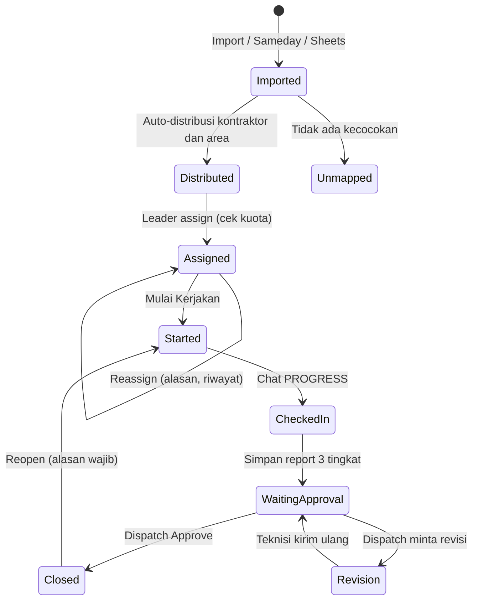
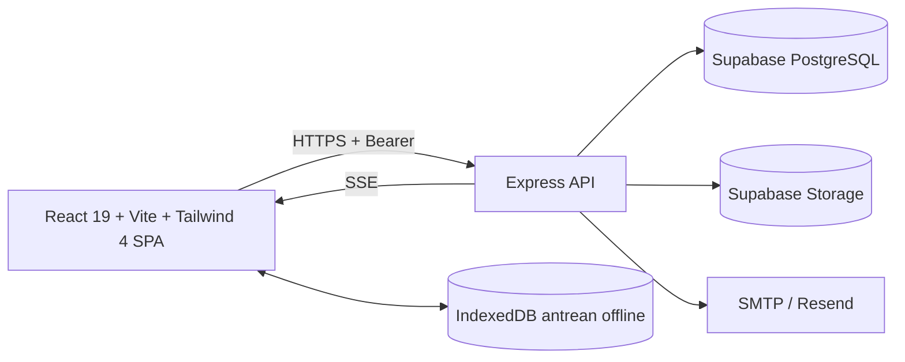

# PRD — Platform Dispatch & Work Order Lapangan FTTH

**Produk referensi:** MoraJaws (repositori MJ-main) · **Versi:** 1.0 · **Tanggal:** 24 November 2026 · **Dasar penyusunan:** analisis kode, migrasi SQL (001–019), daftar 200 endpoint Express, dan dokumen audit/appflow di repositori.

---

## 1. Ringkasan Eksekutif

Produk ini adalah sistem manajemen **Work Order (WO) dan dispatch lapangan** untuk layanan FTTH (Fiber to the Home). Sistem menghubungkan tim pusat (Super Admin, Dispatch) dengan mitra pelaksana di lapangan (Leader/Korlap dan Installer/Teknisi) dalam satu alur: WO diimpor, didistribusikan otomatis ke kontraktor dan area, ditugaskan ke teknisi, dikerjakan dengan bukti check-in dan foto bergeotag, dilaporkan dalam 3 tingkat, lalu diverifikasi (approve atau revisi) oleh Dispatch sebelum ditutup.

Karakteristik utama yang harus dipertahankan pada produk serupa:

- **Satu jalur data:** Browser → Express API → Supabase PostgreSQL. Browser tidak pernah mengakses database langsung.
- **Aturan tanggal operasional WIB** (`Asia/Jakarta`): Leader dan Installer hanya melihat WO dengan `appointmentDate` hari ini; reset otomatis pukul 00:00 WIB.
- **Isolasi per role dan per kontraktor/area**, ditegakkan di backend, bukan hanya di UI.
- **Mobile-first untuk lapangan** (Installer tanpa sidebar, bottom navigation) dengan antrean offline dan sinkronisasi realtime (SSE).
- **Konfigurasi dinamis** (menu, kolom, droplist laporan, template, SLA, GPS) tanpa deploy ulang.

## 2. Latar Belakang dan Masalah

| Masalah operasional | Dampak | Respons produk |
| --- | --- | --- |
| WO datang dari spreadsheet/teks dengan format tidak seragam | Data salah, duplikat, tidak terdistribusi | Importer dengan pemetaan 46 field kanonik, validasi ketat, laporan duplikat |
| Penugasan teknisi manual lewat chat | Teknisi kelebihan beban, riwayat hilang | Assign/reassign dengan kuota harian, slot waktu, dan riwayat permanen |
| Tidak ada bukti teknisi benar-benar di lokasi | Laporan fiktif, sengketa dengan vendor | Check-in wajib via chat kategori PROGRESS, foto bergeotag, GPS live |
| Konfirmasi pelanggan tidak terlacak | Kunjungan sia-sia | Template WhatsApp dengan pelacakan status konfirmasi |
| Kontrol kualitas laporan lemah | WO ditutup tanpa verifikasi | Alur approval Dispatch dan riwayat laporan append-only |
| Kinerja vendor tidak terukur | Sulit menegakkan SLA/PKS | Dashboard SLA per kontraktor, tindakan governance, ledger PKS |
| Sinyal lemah di lapangan | Data hilang | Antrean mutasi IndexedDB dan auto-replay |

## 3. Sasaran, Metrik, dan Non-Goals

**Sasaran produk**

1. Seluruh WO hari ini terdistribusi ke Leader yang benar tanpa intervensi manual (target ≥ 95% otomatis).
2. Setiap WO selesai memiliki bukti check-in, laporan 3 tingkat, dan keputusan Dispatch yang tercatat.
3. Dispatch dan Leader melihat status lapangan secara realtime (latensi pembaruan < 5 detik pada koneksi normal).
4. Teknisi dapat bekerja penuh dalam kondisi sinyal buruk tanpa kehilangan data.

**Metrik sukses**

| Metrik | Target awal |
| --- | --- |
| Tingkat WO tervalidasi saat import (baris valid / total) | ≥ 98% |
| Waktu respons Dispatch terhadap laporan masuk | ≤ 45 menit (konfigurabel, default SLA) |
| First Time Right (FTR) | ≥ 95% |
| SLA kontraktor (global) | ≥ 98,4% (Excellent ≥ 98, Good ≥ 94, Warning ≥ 90) |
| Mutasi offline yang berhasil tersinkron | ≥ 99,5% |
| Insiden kebocoran secret / akses lintas scope | 0 |

**Non-goals (v1):** aplikasi native terpisah, billing/penagihan, manajemen inventori perangkat, optimasi rute otomatis, integrasi WhatsApp Business API resmi (v1 memakai click-to-chat `wa.me`), multi-tenant antar-operator.

## 4. Persona dan Role

Role final dalam kode adalah **4 role**: `super_admin`, `dispatch`, `leader`, `installer`. Role `management_data` dan `it_support` pada dokumen lama telah **dilebur ke super\_admin** (migrasi 017); seluruh fungsinya (import, purge, backup, audit, health) kini milik Super Admin.

| Role | Tujuan utama | Scope data | Landing | Shell |
| --- | --- | --- | --- | --- |
| **Super Admin** | Mengelola sistem, data, user, konfigurasi, audit | Global | Dashboard | Sidebar + Header |
| **Dispatch** | Memantau WO, konfirmasi pelanggan, verifikasi laporan, Sameday | Global | Tickets | Sidebar + Header |
| **Leader (Korlap)** | Mendistribusikan WO ke teknisi, mengelola kuota dan tim | Terkunci ke kontraktor dan area miliknya, hanya WO hari ini | Assign WO | Sidebar + bottom nav 5 tab |
| **Installer (Teknisi)** | Mengerjakan WO, check-in, melapor | Hanya WO yang ditugaskan kepadanya, hari ini | Dashboard Installer | Tanpa sidebar, bottom nav 4 tab |

### Matriks akses modul

| Modul | Super Admin | Dispatch | Leader | Installer |
| --- | :-: | :-: | :-: | :-: |
| Dashboard Monitoring | ✓ | ✓ | ✓ | – |
| Tickets (tabel WO, 46 kolom) | ✓ | ✓ | – | – |
| Contact Centre / Live Chat | ✓ | ✓ | ✓ (scoped) | ✓ (WO sendiri) |
| Report Data WO | ✓ | ✓ | – | – |
| Import Data WO | ✓ | – | – | – |
| Form Sameday | – | ✓ (eksklusif) | – | – |
| Overdue WO | ✓ | ✓ | ✓ | – |
| Schedule | ✓ | ✓ | ✓ | – |
| Assign / Reassign / Dashboard Progress / Rekap Kontraktor / Basecamp / Kuota | ✓ | – | ✓ | – |
| Monitoring SLA | ✓ | ✓ | ✓ | – |
| Tugas Saya & Laporan | ✓ | – | – | ✓ |
| Management User, Role, Setup Terpusat, Field Mapping, UI Builder, Nav Config | ✓ | – | – | – |
| Setting Droplist (kategori report 3 tingkat) | ✓ | ✓ | – | – |
| Audit Log, Login Log, System Health, Database, Sheets Sync | ✓ | – | – | – |
| Monitoring GPS teknisi | ✓ | ✓ | ✓ (scoped) | – (hanya mengirim lokasi) |

Pendaftaran akun teknisi dilakukan Leader dalam scope kontraktornya; akun staf lain oleh Super Admin.

## 5. Aturan Bisnis Inti (Wajib)

1. **Tanggal kanonis:** `appointmentDate` adalah satu-satunya penentu visibilitas appointment; tidak ada fallback ke kolom `date` generik.
2. **Zona waktu bisnis:** `Asia/Jakarta`. Klasifikasi dihitung di database (view `v_work_orders_classified`) agar benar pada 00:00 WIB walau tidak ada user login.
3. **Klasifikasi WO:** `TODAY`, `UPCOMING`, `OVERDUE`, `COMPLETED`, `EXCEPTION` (tanpa tanggal). OVERDUE adalah klasifikasi tampilan; **status asli WO tidak pernah ditimpa**.
4. **Cross-date search** (cari lintas tanggal berdasarkan nomor WO atau ID customer) hanya untuk Super Admin dan Dispatch.
5. **Validasi import wajib:** ID customer 7 digit (`^[0-9]{7}$`), nomor WO, nama jalan, nama cluster, FAT, FDT, telepon pelanggan, nama kontraktor, area. Baris invalid **ditolak**, tidak dilengkapi data karangan.
6. **Duplikat dilaporkan, tidak dihapus otomatis** (mode `skip` atau `update_allowed`).
7. **Kontraktor baru** pada file import didaftarkan otomatis; WO tanpa pemetaan kontraktor/area masuk antrean **Belum Terdistribusi** dengan alert ke Dispatch/Super Admin.
8. **Check-in wajib:** laporan tidak dapat disimpan sebelum ada minimal satu pesan live chat kategori `PROGRESS` (error `CHECK_IN_REQUIRED`).
9. **Kuota harian teknisi:** default 4 WO per teknisi, dapat dikustom per teknisi, dengan mode strict limit.
10. **Slot waktu:** 09:00–11:00, 11:00–13:00, 13:00–15:00, 15:00–17:00 WIB.
11. **Reassign** selalu mensyaratkan alasan dan menyimpan riwayat permanen (`assignment_history`); teknisi lama dan baru diberi notifikasi.
12. **Audit log kritis** harus berhasil tersimpan sebelum aksi dinyatakan sukses.
13. **Fail-closed:** jika database tidak tersedia di produksi, API menolak (tidak ada fallback ke penyimpanan lokal/JSON).
14. **Soft delete** (dengan alasan dan konfirmasi diketik) dan **archive** untuk WO; hard delete tidak tersedia di UI. WO yang dilindungi dijaga trigger database.
15. **Retensi:** purge WO per tanggal (retensi default 7 hari) hanya Super Admin; riwayat GPS 30 hari.

## 6. Workflow End-to-End

### 6.1 Empat dimensi status per tiket

| Dimensi | Nilai |
| --- | --- |
| **Status WO Agent** (administratif) | Pending, Assigned, In Progress, Resolved/Done, Closed, Cancelled |
| **Status WO Installer** (eksekusi) | Unassigned, Assigned, En Route, On Site, In Progress, Pending Technical, Completed, Installed, Failed/Cancelled |
| **Status WhatsApp** (konfirmasi pelanggan) | ready, opened\_in\_whatsapp, awaiting\_confirmation, confirmed, reschedule\_requested, unreachable |
| **Approval** | NONE, BUTUH APPROVAL, APPROVED, REVISION/REJECTED |

Status laporan teknisi (Level 1): **PENDING, COMPLETE, RESCHEDULE, CANCEL**.

### 6.2 Alur utama

1. **Ingesti:** Super Admin mengimpor XLSX/CSV/teks tabel (pipe/tab), atau Dispatch membuat WO lewat Form Sameday, atau sinkronisasi Google Sheets. Mesin pemetaan memvalidasi dan mendeteksi duplikat; hasil ditampilkan dalam preview per kategori (valid, duplikat, invalid) sebelum dikonfirmasi.
2. **Distribusi otomatis:** WO dengan kontraktor dan area yang cocok masuk ke antrean Leader terkait (status Pending/Unassigned) dan dicatat di `wo_distribution_logs`. Leader menerima notifikasi (in-app dan email `new_wo_leader`).
3. **Konfirmasi pelanggan:** Dispatch atau teknisi membuka modal WhatsApp, memilih template, mengirim lewat `wa.me`, lalu mencatat hasil (confirmed, reschedule\_requested, unreachable).
4. **Penugasan:** Leader menetapkan teknisi dan slot (satuan, massal, atau unggah Excel) dengan memeriksa kuota harian. Teknisi menerima notifikasi (in-app dan email `wo_assigned_installer`). Reassign dapat dilakukan dengan alur dua langkah dan alasan wajib.
5. **Eksekusi:** Teknisi menekan **Mulai Kerjakan** (`workStartedAt`), lalu **check-in** dengan mengirim pesan live chat kategori PROGRESS (foto opsional). Foto bukti diambil lewat kamera bergeotag untuk 6 slot (lihat 7.4).
6. **Laporan 3 tingkat (check-out):** Report Status → Reason Report → Rootcause, ditambah Remarks, OPM (dBm), SN ONT, dan foto sebelum/sesudah (maks 5 MB). Penyimpanan menghasilkan `approvalStatus = BUTUH APPROVAL` dan entri append-only di `wo_progress_report_history`. Bila terhambat, teknisi dapat mengirim **Laporan Kendala** (alasan, deskripsi, foto wajib).
7. **Verifikasi Dispatch:** **Approve** (hasil: Done/Pending/Reschedule/Cancel, WO menjadi Closed bila Done), atau **Request Revision/Reject** dengan alasan; teknisi merevisi dan mengirim ulang (versi laporan bertambah).
8. **Pasca-penutupan:** Dispatch/Super Admin dapat **Reopen** dengan alasan tertulis; Super Admin dapat archive/soft-delete.

## 7. Persyaratan Fungsional

Prioritas: **P0** wajib rilis awal, **P1** rilis kedua, **P2** peningkatan.

### 7.1 Autentikasi dan Sesi

| ID | Persyaratan | Prio |
| --- | --- | --- |
| AUTH-1 | Login username atau email + password; username diselesaikan ke email kanonis di backend; endpoint resolve tidak membocorkan email | P0 |
| AUTH-2 | Token akses + refresh, logout menaikkan `sessionVersion` (revokasi), akun nonaktif ditolak | P0 |
| AUTH-3 | Rate limit dan lockout: 5 percobaan gagal dalam 15 menit mengunci akun 15 menit; semua percobaan dicatat | P0 |
| AUTH-4 | Kode error terstruktur (MJ-AUTH-001..005, MJ-AUTH-LOCK, MJ-DB-001) tanpa membocorkan detail sensitif | P0 |
| AUTH-5 | Konfigurasi sesi: durasi maks 8 jam, idle 60 menit, perpanjang saat aktivitas, maks 3 sesi aktif, revoke saat deaktivasi dan ganti password | P0 |
| AUTH-6 | Wajib ganti password pertama (force change), kebijakan password, riwayat password mencegah pemakaian ulang | P0 |
| AUTH-7 | Manajemen sesi aktif (lihat dan cabut) oleh user dan Super Admin; Login Log | P0 |
| AUTH-8 | Reset password massal berbasis job (buat, batalkan, ulangi, rollback, laporan) dengan token sekali pakai berkedaluwarsa (hash SHA-256), tanpa menyimpan password plaintext | P1 |

### 7.2 Ingesti WO

| ID | Persyaratan | Prio |
| --- | --- | --- |
| IMP-1 | Input: unggah XLSX/CSV dan tempel teks tabel; pemetaan kolom manual (modal) dengan memori mapping; 46 field kanonik | P0 |
| IMP-2 | Validasi sesuai aturan 5; preview per kategori; laporan import yang dapat diekspor | P0 |
| IMP-3 | Deteksi duplikat (nomor WO) dengan mode skip atau update\_allowed; tidak ada penghapusan otomatis | P0 |
| IMP-4 | Normalisasi nomor telepon, parser tanggal appointment, kolom tak terpetakan disimpan di `unmapped_headers` | P0 |
| IMP-5 | Template unduhan (3 format) dan filter tanggal import; riwayat batch (`import_batch_id`) | P1 |
| IMP-6 | Form Sameday (Dispatch): pembuatan satu WO hari yang sama dengan validasi identik | P0 |
| IMP-7 | Sinkronisasi Google Sheets (uji koneksi, tarik data, riwayat sync) | P1 |
| IMP-8 | Purge per tanggal dan unduh backup produksi (JSON) oleh Super Admin, dengan konfirmasi dan audit | P1 |

### 7.3 Distribusi dan Penugasan (Leader)

| ID | Persyaratan | Prio |
| --- | --- | --- |
| ASG-1 | Feed penugasan Leader terfilter kontraktor/area dan hari ini; badge jumlah unassigned | P0 |
| ASG-2 | Assign satuan, massal, dan via unggah Excel; matriks slot × teknisi | P0 |
| ASG-3 | Kuota harian default dan kustom per teknisi, strict enforcement, sidebar kuota | P0 |
| ASG-4 | Reassign satuan/massal dengan alasan wajib dan alur dua langkah; riwayat permanen | P0 |
| ASG-5 | Dashboard Progress Leader: kategori Unassign, Assign, Untouch, Complete, Uncomplete, Cancel; durasi kerja; ekspor XLSX/salin | P0 |
| ASG-6 | Manajemen teknisi (daftar, tambah, aktif/nonaktif) dan pengaturan kolom tabel Leader | P0 |
| ASG-7 | Master kontraktor, area cakupan, dan basecamp; rekap WO per kontraktor/area | P0 |

### 7.4 Eksekusi Lapangan (Installer)

| ID | Persyaratan | Prio |
| --- | --- | --- |
| INS-1 | Dashboard: identitas, 5 counter KPI, notifikasi penugasan baru, tombol cepat Mulai Kerjakan | P0 |
| INS-2 | Tugas Saya: filter All, Pending, Butuh Approval, Done, Reschedule, Cancel; kartu tiket mobile | P0 |
| INS-3 | Fullview tiket: detail, peta lokasi, tombol Google Maps, chat, form laporan, matriks foto | P0 |
| INS-4 | **Foto bukti bergeotag, 6 slot:** OPM, barcode/SN, tiang FAT, instalasi pelanggan, rumah pelanggan, redaman FAT. Metadata: lat/long, akurasi, waktu, metode capture, status geotag, ID capture klien untuk idempotensi retry | P0 |
| INS-5 | Check-in via kamera bergeotag dan pemindai barcode (ZXing) untuk SN perangkat | P0 |
| INS-6 | Penyimpanan Lokasi Rumah dan Lokasi FAT pada WO dari hasil geotag | P1 |
| INS-7 | Laporan 3 tingkat (droplist hierarkis dikelola Admin), validasi OPM terhadap ambang SLA, jumlah foto minimum | P0 |
| INS-8 | Laporan Kendala dengan foto wajib; status Pending Technical | P0 |
| INS-9 | **GPS gate:** lokasi dikirim otomatis saat login (lihat 7.11); blokir/peringatan bila izin GPS ditolak | P1 |

### 7.5 Live Chat dan Contact Centre

| ID | Persyaratan | Prio |
| --- | --- | --- |
| CHT-1 | Chat per tiket dengan kategori (`chatCategories`, termasuk PROGRESS), lampiran foto JPG/PNG/WebP maks 5 MB dengan pratinjau | P0 |
| CHT-2 | Status pesan: terkirim, delivered, dibaca; unread counter; indikator mengetik; presence | P0 |
| CHT-3 | Contact Centre 3 panel: filter kategori, pencarian isi chat, detail tiket (drawer); scoped per role | P0 |
| CHT-4 | Pesan PROGRESS pertama menetapkan `checkInAt` | P0 |

### 7.6 WhatsApp

| ID | Persyaratan | Prio |
| --- | --- | --- |
| WA-1 | Template dengan variabel (`{{customer_name}}`, `{{wo_number}}`, dst.) dan pratinjau render di server | P0 |
| WA-2 | Click-to-chat `wa.me`, pencatatan `opened_in_whatsapp` dan hasil konfirmasi | P0 |
| WA-3 | Pusat WhatsApp Installer (template yang diizinkan) dan editor template Admin | P1 |

### 7.7 Approval Dispatch

| ID | Persyaratan | Prio |
| --- | --- | --- |
| APR-1 | Banner di detail tiket: Approve (dengan hasil Done/Pending/Reschedule/Cancel + catatan), Request Revision/Reject (alasan wajib), Close, Reopen | P0 |
| APR-2 | Setiap keputusan tercatat append-only dengan pelaku, waktu, versi | P0 |
| APR-3 | Hitungan status approval hari ini di header tabel tiket | P0 |

### 7.8 Tiket, Overdue, Jadwal, Laporan

| ID | Persyaratan | Prio |
| --- | --- | --- |
| TKT-1 | Tabel dinamis 46 kolom: sort 3 status, filter, visibilitas dan urutan kolom, preset desktop/Android, mode auto/table/cards, pagination | P0 |
| TKT-2 | Detail tiket: status alur kerja, 3 kartu ringkasan, grid kolom terisi saja, riwayat reassign, chat, laporan, foto | P0 |
| TKT-3 | Overdue WO: daftar WO appointment lampau yang belum selesai, badge jumlah, aksi tindak lanjut | P0 |
| TKT-4 | Schedule: kalender Day/Week/Month/List dengan penanda overdue dan unscheduled | P1 |
| TKT-5 | Report Data WO: 10 preset (all\_wo, wo\_agent, wo\_installer, pending, completed, overdue, reassign\_history, contractor\_sla, root\_cause, incomplete\_data), filter per kolom, ekspor XLSX | P0 |
| TKT-6 | Riwayat laporan progres (`progress-history`) untuk audit per WO | P0 |

### 7.9 Dashboard dan KPI

| ID | Persyaratan | Prio |
| --- | --- | --- |
| DSH-1 | Dashboard Overview: Total WO Aktif, Perlu Perhatian, Dalam Pengerjaan, Selesai + akses cepat | P0 |
| DSH-2 | KPI lifecycle dari satu sumber server: total hari ini, unassigned, assigned, belum check-in, check-in/progress, report per status, butuh approval, approved per hasil, revision/rejected, closed, unmapped distribution; breakdown vendor, area, leader, installer | P0 |
| DSH-3 | Kartu KPI dapat diklik menjadi filter pada tabel | P1 |

### 7.10 SLA Monitoring Kontraktor/Vendor

| ID | Persyaratan | Prio |
| --- | --- | --- |
| SLA-1 | Periode today, 7d, MTD; tier EXCELLENT/GOOD/WARNING/CRITICAL/NO\_DATA berdasarkan ambang konfigurabel | P1 |
| SLA-2 | Peringkat vendor: SLA rate, volume, OK/WIP/Late, on-time rate, FTR, rata-rata respons, utilisasi kuota, jumlah breach | P1 |
| SLA-3 | Tren per slot, matriks kepatuhan, daftar tiket breach dengan sisa menit | P1 |
| SLA-4 | Aksi governance tercatat: Tegur Korlap, Issue SP1, Mass Alert, Eskalasi Dispatch, Bypass Permit, Kirim Bantuan, Ping Teknisi | P1 |
| SLA-5 | Aturan PKS: bonus per WO patuh, toleransi minimum, penalti per WO breach, referensi klausul | P2 |

Default konfigurasi: target global 98,4; ambang Excellent 98 / Good 94 / Warning 90; FTR 95; respons Dispatch maks 45 menit; redaman OPM ≥ −22,0 dBm; minimum 4 foto; kuota 4 WO per teknisi.

### 7.11 GPS Tracking Live Teknisi

| ID | Persyaratan | Prio |
| --- | --- | --- |
| GPS-1 | Sesi teknisi otomatis dimulai saat login; heartbeat tiap 60 detik, timeout 150 detik; satu sesi aktif per teknisi (sesi lama diganti) | P1 |
| GPS-2 | Status online/offline dipisah dari status lokasi: Location Fresh, Stale (180 dtk), GPS Disabled, Permission Denied, No Signal, Waiting for GPS | P1 |
| GPS-3 | Lokasi terakhir (satu baris per teknisi) dan riwayat breadcrumb, retensi 30 hari; upsert atomik lewat RPC; tolak koordinat 0,0 dan di luar rentang | P1 |
| GPS-4 | Kirim lokasi per 60 detik atau 15 meter; antrean offline maks 100 entri dan batch resync; tolak akurasi > 500 m | P1 |
| GPS-5 | Peta monitoring (Leaflet) dengan filter, tampil sesuai scope role | P1 |

### 7.12 Notifikasi

| ID | Persyaratan | Prio |
| --- | --- | --- |
| NTF-1 | Notifikasi in-app: bell, drawer, toast, banner, filter, pengaturan; badge navigasi | P0 |
| NTF-2 | Audio notifikasi per kejadian dengan pengaturan (Sound Settings) | P1 |
| NTF-3 | **Email otomatis**, 7 template: daily\_reset\_leader, daily\_reset\_installer, new\_wo\_leader, wo\_assigned\_installer, wo\_reassigned\_prev\_installer, wo\_reassigned\_new\_installer, daily\_summary | P1 |
| NTF-4 | Email: antrean idempoten (`event_key` unik), retry maks 3 kali, log pengiriman, webhook status penyedia, preview/uji kirim/uji koneksi, template dapat disunting Admin, URL dasar harus HTTPS | P1 |
| NTF-5 | Pemicu terjadwal reset harian dan ringkasan harian | P1 |

### 7.13 Setup Terpusat dan Konfigurasi

| ID | Persyaratan | Prio |
| --- | --- | --- |
| CFG-1 | Hub setup dengan tab: master data, navigasi, kolom/UI, database & sync, user, role, kategori report, template WhatsApp, workflow, notifikasi/audio, kesehatan dan log | P0 |
| CFG-2 | Navigasi dinamis: 3 kategori accordion (Contractor & Area, Installer, Menu Tambahan) + menu mandiri; visibilitas per role; tersimpan di `app_settings` | P0 |
| CFG-3 | Konfigurasi global berversi: simpan, riwayat versi, rollback, deteksi konflik (modal) | P1 |
| CFG-4 | Droplist report 3 tingkat (Status → Reason → Rootcause) dan kategori chat, dikelola tanpa deploy | P0 |
| CFG-5 | Field mapping engine dan UI Configuration Builder (Table Columns Studio) | P1 |
| CFG-6 | Role & Permission granular (izin JSONB per role), diperiksa di backend | P0 |

### 7.14 Audit, Kesehatan, dan Data Ops

| ID | Persyaratan | Prio |
| --- | --- | --- |
| OPS-1 | Audit trail tak dapat diubah: aktor, aksi, entitas, state sebelum/sesudah, IP, waktu; viewer dengan filter | P0 |
| OPS-2 | Health check menguji koneksi nyata ke database; halaman System Health; log error sistem | P0 |
| OPS-3 | Monitoring sinkronisasi dan status SSE; manajemen database (Database Application) | P1 |
| OPS-4 | Dashboard kualitas data: duplikat, ID bukan 7 digit, tanggal kosong, tanpa kontraktor | P1 |

### 7.15 Offline dan Realtime

| ID | Persyaratan | Prio |
| --- | --- | --- |
| SYN-1 | Antrean mutasi IndexedDB, badge pending, modal sinkronisasi offline, auto-replay saat online | P0 |
| SYN-2 | SSE hub untuk broadcast perubahan tiket, chat, dan notifikasi; endpoint delta sync | P0 |
| SYN-3 | Indikator header: Online/Syncing/Offline dan status cloud (SAVED, SYNCING, LOADING, OFFLINE, ERROR) | P0 |
| SYN-4 | Resolusi konflik last-write dengan peringatan untuk entitas kritis | P1 |

## 8. Model Data (PostgreSQL)

Semua tabel berada di skema `public` dengan RLS aktif; akses aplikasi hanya lewat service role dari Express.

| Kelompok | Tabel |
| --- | --- |
| Identitas | `roles`, `users` (hash password, role, kontraktor, area, soft delete, `session_version`, token reset), `auth_sessions`, `user_sessions`, `refresh_tokens`, `login_attempts`, `session_config`, `user_preferences`, `password_reset_jobs`, `password_reset_job_items` |
| Master | `contractors`, `coverage_areas` |
| WO inti | `work_orders` (±100 kolom: identitas, pelanggan, jadwal, infrastruktur FTTH, penugasan, 4 status, approval, soft delete/archive, `additional_fields`, `payload` JSONB), view `v_work_orders_classified` |
| Alur kerja | `assignment_history`, `wo_distribution_logs`, `wo_progress_report_history` (append-only), `technical_reports`, `wo_kendala_reports`, `wo_photo_evidence`, `ticket_messages`, `attachments` |
| Lapangan | `installer_sessions`, `installer_current_locations`, `installer_location_history` |
| Konfigurasi | `app_settings`, `global_config_versions`, `report_categories`, `wa_templates`, `integration_configs` |
| Notifikasi | `email_notification_settings`, `email_notification_templates`, `email_notification_queue`, `email_delivery_logs` |
| Observabilitas | `audit_logs`, `system_error_logs`, `sync_history` |

Kelompok field WO (dari 46 kolom kanonik): identitas WO dan pelanggan; lokasi (jalan, cluster, area, koordinat, lokasi rumah/FAT); appointment (tanggal, slot, kategori); jaringan (OLT, FDT, FAT, port, panjang dropcore, redaman, perangkat ONT/router/STB beserta SN dan MAC); kontraktor, leader, installer; status dan approval; metadata import.

## 9. Arsitektur dan API

**Prinsip:** satu database produksi, satu sistem autentikasi, satu jalur akses (Express). Secret hanya di server; tidak ada service-role key di bundel frontend. Setiap endpoint privat memvalidasi token, status akun, versi sesi, RBAC, dan scope kontraktor/area/kepemilikan.

**Kelompok API (±200 endpoint pada referensi):** `auth` (login, refresh, logout, ganti/reset password, resolve identity), `users` dan `admin/users`, `tickets` dan `work-orders` (CRUD, bulk-import, sameday, assign, reassign, progress-report, approve-report, request-revision, kendala-report, photo-evidence, messages, purge), `leader` (assignment-feed, quota-config), `installer-tracking` (session, heartbeat, location, live, history), `livechat`, `contractors`, `coverage-areas`, `roles`, `sla` (config, telemetry, actions), `email-notifications`, `global-config`, `settings`, `storage` (upload, signed URL, verifikasi), `integrations/google-sheets`, `sessions`, `audit-logs`, `reports`, `dashboard/kpi-summary`, `sync`, `realtime`, `health`, `system/operational-date`, `admin/backup/download`.

**Stack:** React 19, Vite 6, Tailwind CSS 4, Lucide, Motion, Leaflet, ZXing, SheetJS (xlsx), bcryptjs, Express 4, Supabase JS, Nodemailer/Resend. Disarankan memisahkan file server monolit menjadi modul per domain sejak awal.

## 10. Persyaratan Non-Fungsional

| Area | Persyaratan |
| --- | --- |
| **Keamanan** | Secret hanya di environment server; password di-hash bcrypt; tidak ada log password/token; CORS dan redirect origin whitelist; HTTPS produksi; RLS di semua tabel; validasi scope di backend; tidak ada akun default produksi |
| **Keandalan** | Fail-closed pada kegagalan database; operasi idempoten (retry foto, email, import); migrasi SQL idempoten dan non-destruktif dengan rencana rollback; backup dapat diunduh |
| **Performa** | Tabel 5.000+ baris dengan pagination dan indeks parsial (`appointment_date`, status); muat awal dashboard < 3 detik pada 4G; pembaruan SSE < 5 detik |
| **Offline** | Teknisi dapat membuka tugas, mengambil foto, dan menyusun laporan tanpa sinyal; antrean dipertahankan setelah aplikasi ditutup |
| **Kompatibilitas** | Browser modern Chrome/Edge/Safari; viewport desktop 1440, tablet, dan mobile 390; target sentuh dapat diatur (compact, comfortable, large) |
| **Aksesibilitas** | Kontras memadai, dukungan `prefers-reduced-motion`, fokus keyboard, label form |
| **Observabilitas** | Log error sistem terstruktur, audit log, health check nyata, monitoring sinkronisasi |
| **Privasi** | Data lokasi hanya untuk peran berwenang, retensi 30 hari, izin GPS eksplisit, email tidak diekspos di endpoint publik |
| **Lokalisasi** | Bahasa Indonesia, zona Asia/Jakarta, format tanggal dan angka Indonesia |

## 11. UI/UX

- **Identitas visual:** tema Dark Purple Gloss + Lilac (`#160D29`, `#35105E`, `#7135B5`, `#A855F7`, kanvas terang `#F5F1FF`), glassmorphism ringan, animasi singkat dengan dukungan reduced-motion.
- **Shell responsif:** (1) desktop sidebar collapsible 3 state (expanded, minimized, closed) dengan header 3 zona; (2) Leader: bottom nav 5 tab (Assign WO, Dashboard Progress, Teknisi, Rekap Total WO, Kuota & Kolom); (3) Installer: tanpa sidebar, bottom nav 4 tab (Dashboard, Tugas Saya, WhatsApp, Live Chat Center); (4) mobile non-Leader/Installer: bottom nav 5 tab cepat.
- **Pola komponen:** tabel responsif yang berubah menjadi kartu di mobile, modal yang menyesuaikan keyboard (visual viewport), konfirmasi dengan ketik teks untuk aksi destruktif, skeleton loading, empty state, error boundary, banner offline.
- **Layar inti:** Login Staf; Dashboard; Tickets + Detail; Form Sameday; Import + Laporan Import; Assign Matrix Leader; Dashboard Progress; Tugas Installer + Fullview + Form Laporan + Kamera Geotag; Contact Centre; Schedule; Overdue; SLA; Peta Monitoring; Setup Hub; Audit/Login Log/System Health.

## 12. Rencana Rilis

| Fase | Cakupan | Kriteria selesai |
| --- | --- | --- |
| **0. Fondasi** | Skema DB + RLS, Express, auth kustom di atas Supabase, RBAC, audit, health, CI (lint, build, test) | Login 4 role, rate limit, fail-closed teruji |
| **1. Inti WO** | Import, validasi, duplikat, auto-distribusi, tabel tiket, detail, klasifikasi WIB | Import 1.000 baris valid, WO tampil sesuai scope |
| **2. Penugasan dan lapangan** | Assign/reassign, kuota, portal Installer, chat PROGRESS, laporan 3 tingkat, approval, riwayat | Satu WO selesai end-to-end dengan bukti |
| **3. Bukti dan komunikasi** | Foto geotag 6 slot, scanner, kendala, WhatsApp, Contact Centre, notifikasi in-app/audio | Foto idempoten, status WA tercatat |
| **4. Realtime dan offline** | SSE, antrean IndexedDB, delta sync, indikator koneksi | Uji putus-sambung tanpa kehilangan mutasi |
| **5. Monitoring dan governance** | KPI, SLA, overdue, schedule, report, GPS live dan peta, email otomatis | Dashboard sesuai angka database |
| **6. Administrasi lanjut** | Setup Hub, nav config, config berversi, UI builder, reset password massal, Google Sheets, backup/purge | Perubahan konfigurasi tanpa deploy |
| **7. Hardening dan go-live** | Uji beban, uji keamanan, UAT per role, runbook, pelatihan | Checklist go-live disetujui |

## 13. Risiko, Asumsi, dan Pertanyaan Terbuka

**Risiko**

| Risiko | Mitigasi |
| --- | --- |
| File server monolit besar (±677 KB) sulit dirawat dan rawan jalur data yang lolos pemeriksaan mode database | Modularisasi per domain; satu repository layer; tes kontrak endpoint |
| Fallback senyap ke penyimpanan lokal/JSON | Fail-closed di produksi; tes yang memverifikasi perilaku, bukan sekadar string |
| Beban dan akurasi GPS di perangkat murah | Interval adaptif, ambang akurasi, antrean offline, status eksplisit |
| Foto bukti besar menghabiskan kuota/sinyal | Kompresi di klien, batas 5 MB, upload bertahap idempoten |
| Akses lintas scope karena kecocokan nama kontraktor berbasis teks (`LIKE`) | Gunakan `contractor_id` sebagai kunci scope, bukan pencocokan nama |
| Migrasi sistem lama (Firebase/JSON) | Migrasi bertahap, dry-run, rollback, persetujuan eksplisit sebelum menyentuh produksi |
| Kebijakan RLS yang longgar pada beberapa tabel referensi (mis. SELECT untuk semua authenticated pada foto) | Tinjau ulang; perketat sesuai scope role |

**Asumsi**

- Dokumen ini mengikuti **kode terbaru (4 role)**, bukan dokumen appflow lama yang masih menyebut 6 role.
- WhatsApp v1 memakai click-to-chat, bukan API resmi, sehingga status balasan pelanggan dicatat manual.
- Kunci Gemini pada repositori berasal dari template AI Studio; tidak ada fitur AI yang aktif pada kode aplikasi, sehingga tidak dimasukkan sebagai persyaratan.
- Kredensial seed pada README migrasi hanya untuk pengembangan dan tidak boleh dipakai di produksi.

**Pertanyaan terbuka**

1. Apakah produk baru melayani satu operator (seperti MyRepublic) atau perlu dikonfigurasi untuk beberapa operator?
2. Apakah peran Management Data dan IT Support perlu dipisahkan kembali demi prinsip least privilege?
3. Apakah diperlukan integrasi WhatsApp Business API resmi atau tanda tangan digital pelanggan pada v1?
4. Berapa volume WO harian dan jumlah teknisi aktif untuk menentukan target kapasitas?
5. Apakah ada kewajiban retensi data atau regulasi privasi yang menentukan masa simpan foto dan lokasi?

## 14. Lampiran: Kode Error dan Peristiwa Penting

| Kode / peristiwa | Arti |
| --- | --- |
| `CHECK_IN_REQUIRED` | Laporan ditolak karena belum ada chat PROGRESS |
| `MJ-AUTH-001..005`, `MJ-AUTH-LOCK` | Kegagalan autentikasi, akun terkunci |
| `MJ-DB-001` | Database tidak tersedia (fail-closed) |
| `NEEDS_MAPPING`, `AUTH_UID_MISMATCH` | Akun staf belum dipetakan ke identitas autentikasi; perlu persetujuan Super Admin |
| `DISPATCH_APPROVED`, `DISPATCH_REVISION_REQUESTED`, `REPORT_SUBMITTED` | Tipe peristiwa pada riwayat laporan progres |
